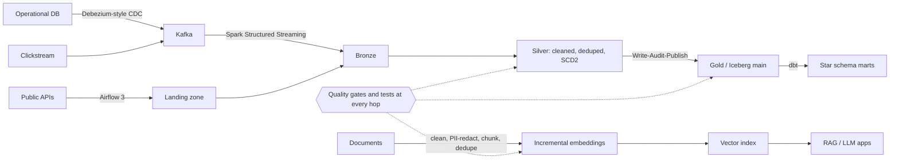

## Hi, I'm Kajal 👋

### Data Engineer · Data platforms for AI and analytics

I build the data layer that AI systems and analytics depend on: ingestion, CDC and streaming, lakehouse
tables, and the RAG pipelines that turn documents into a vector index an LLM can trust. My focus is the
unglamorous part that decides whether a model answers well: **clean, deduplicated, PII-safe, incrementally
updated data, with tests that prove it.**

```text
batch · streaming · CDC · lakehouse (Delta, Iceberg) · dbt · Airflow · RAG ingestion · embeddings · data quality
```

### 🏗️ How my projects fit together

Taken together, my repositories cover the path from a source system to an LLM-ready index or a BI mart.
Every stage below is implemented and tested in one of the projects further down.



### 🧭 How I build pipelines

- **Idempotent by default.** Every job can be rerun or backfilled without duplicates: MERGE upserts, content hashes, checkpoints.
- **Bad data never reaches consumers.** Quality gates, quarantine tables, dead-letter topics and Write-Audit-Publish stop a bad batch before it lands.
- **Incremental, not full rebuilds.** CDC instead of full extracts, and in RAG only changed chunks are re-embedded, with deletes propagated to the index.
- **Proven, not claimed.** Each repo has CI that runs unit tests plus an end-to-end run of the pipeline on every push.
- **AI data needs the same discipline.** PII redaction, dedup and lineage matter as much for an embedding index or a fine-tuning set as for a warehouse table.

### 🔧 Tech I work with


**AI / ML data:**


### 🤖 Data engineering for AI

**[rag-ingestion-pipeline](https://github.com/kaajjalchoudhary/rag-ingestion-pipeline)**: most RAG demos re-embed everything on every run. This treats the vector index like any other table: documents are cleaned, PII-redacted, chunked on paragraph and sentence boundaries, deduplicated and synced **incrementally**, so unchanged docs are skipped, an edited paragraph re-embeds one chunk and deleted files leave nothing behind. Pluggable embedders, offline by default, every guarantee tested in CI.

```bash
pip install git+https://github.com/kaajjalchoudhary/rag-ingestion-pipeline.git
ragprep ingest docs/ && ragprep search "refund window"
```

### 🧰 Open source

**[datasniff](https://github.com/kaajjalchoudhary/datasniff)**: know your data file before you load it. One command profiles any CSV, Parquet or JSON file, flags data quality problems (duplicates, nulls, PII, dirty values) and generates a dbt `schema.yml` with tests plus `CREATE TABLE` DDL for Postgres, BigQuery, Snowflake or DuckDB. Also available as a GitHub Action.

```bash
pip install git+https://github.com/kaajjalchoudhary/datasniff.git
datasniff orders.csv
```

### 🚀 Featured projects


| Area | Project | What it does | Stack |
|---|---|---|---|
| 🤖 AI data | [**RAG Ingestion Pipeline**](https://github.com/kaajjalchoudhary/rag-ingestion-pipeline) | Cleans, PII-redacts, chunks and deduplicates documents, then keeps a vector index in sync incrementally: content-hash skips, embeddings cached per chunk hash and model, deletes propagated. Tests prove a second run is a no-op and a one-paragraph edit re-embeds one chunk | Python · Embeddings · SQLite |
| ⚡ Streaming & CDC | [**CDC Streaming into Delta Lake**](https://github.com/kaajjalchoudhary/cdc-streaming-lakehouse) | Debezium-style change events from Kafka applied to Delta Lake by Spark Structured Streaming, exactly once: LSN-ordered MERGE, soft deletes, idempotent bronze appends, dead letters and checkpoint restarts. Tests prove the Delta table matches the source row for row through a real broker | Kafka · Spark Streaming · Delta Lake |
| 🧊 Lakehouse | [**Iceberg Write-Audit-Publish**](https://github.com/kaajjalchoudhary/iceberg-wap-lakehouse) | Smart-meter pipeline where every batch is merged into an Iceberg branch, audited there and only then fast-forwarded to `main`; a firmware-bug delivery is rejected and its re-delivery published. MERGE with merge-on-read, schema and partition evolution, compaction | PySpark · Apache Iceberg · pytest |
| 🧊 Lakehouse | [**Spark + Delta Lake Lakehouse**](https://github.com/kaajjalchoudhary/spark-delta-lakehouse) | Medallion (bronze/silver/gold) lakehouse for a ride-hailing feed with idempotent daily batches, MERGE upserts for late and corrected events, a reusable SCD Type 2 merge, point-in-time joins, a quarantine table and quality gates that stop bad runs | PySpark · Delta Lake · pytest |
| 🗓️ Orchestration | [**Climate & Air-Quality ELT**](https://github.com/kaajjalchoudhary/climate-elt-airflow) | Airflow 3 DAG that pulls hourly weather and air-quality data for six cities from a public API into a replayable landing zone, with dynamic task mapping, idempotent daily loads and data quality gates | Airflow · DuckDB · Python |
| 📦 Batch | [**NYC Taxi Batch Pipeline**](https://github.com/kaajjalchoudhary/nyc-taxi-batch-pipeline) | Cleans and enriches NYC taxi trips, gates every run with data quality checks, and publishes a partitioned trip table plus daily, hourly, zone and payment aggregates | PySpark · Parquet · pytest |
| ⚡ Streaming & CDC | [**Real-time E-commerce Streaming**](https://github.com/kaajjalchoudhary/realtime-ecommerce-streaming) | Consumes clickstream events from Kafka into event-time tumbling windows with per-partition watermarks, routes bad messages to a dead-letter topic, and upserts funnel metrics into Postgres | Kafka · PostgreSQL · Docker |
| 📊 Analytics engineering | [**Retail Analytics Warehouse**](https://github.com/kaajjalchoudhary/retail-analytics-dbt) | Models messy store extracts into a tested star schema with staging, marts and an incremental model, backed by 39 data tests | dbt · DuckDB · SQL |
| 📊 Analytics engineering | [**SQL Patterns for Data Engineers**](https://github.com/kaajjalchoudhary/sql-patterns-for-data-engineers) | Thirty-six SQL patterns that keep coming up in pipelines (dedupe to latest, gaps and islands, sessionization, SCD Type 2, snapshot diff, as-of joins, merge intervals, orphan records, period-over-period growth, recursive hierarchies, source-to-target reconciliation and more), each with sample data and an expected result checked in CI | SQL · DuckDB |

Every project has CI that runs the tests plus an end-to-end run of the pipeline on every push.

### 🌱 Currently exploring

- Embedding pipelines at scale: streaming document changes from Kafka into a vector store (pgvector)
- Evaluating RAG retrieval with golden question sets (recall@k, chunking strategy comparisons)
- Data quality for LLM training and fine-tuning data (dedup, PII, contamination checks)
- Streaming into Iceberg (Kafka to Iceberg with Flink or Spark)
- Running these pipelines on managed cloud platforms (object storage, managed Spark and Kafka)
