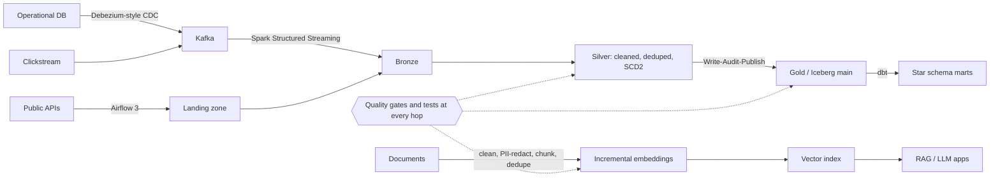

# Kajal Choudhary

**AI & Data Engineer** · GenAI · RAG · AI Agents · MCP · Databricks · PySpark · dbt · SQL · Python

Duisburg, Germany · Authorised to work in the EU · [LinkedIn](https://www.linkedin.com/in/kaajal-choudhary)

---

## Summary

AI and data engineer with 9+ years of experience across retail banking, retail, e-commerce and software. I design
and build end-to-end ETL/ELT pipelines on Databricks, PySpark and dbt, and deliver Generative AI on top of that
foundation: retrieval-augmented generation over enterprise data, AI agents with tool calling and the Model Context
Protocol, and LLM integrations with structured outputs. My work centres on the data quality, reconciliation and
governance that regulated environments require and that determine whether an AI system can be trusted.

## Professional experience

| Period | Role | Organisation | Key contributions |
|---|---|---|---|
| 2025 – present | Senior Data Analyst, Data Engineering, BI & AI | DVK Software · Global bank, credit risk programme | End-to-end Databricks/PySpark/dbt ETL pipelines on GCP feeding credit risk data marts; RAG solutions enabling natural-language access to risk datasets and data definitions; MCP-enabled AI agents automating validation, reconciliation and pipeline documentation; AI-assisted development and code review with Claude Code |
| 2023 – 2025 | Senior Data Analyst | TASC Outsourcing · Emirates NBD (retail banking), Dubai | Retail banking ETL pipelines, data models and reporting structures; customer segmentation and A/B testing; source-to-target mappings and data quality validation across Oracle, SQL Server and SAP |
| 2022 – 2023 | ETL & Data Engineering Analyst | Barclays Global Service Centre, Noida | SAS-to-Hadoop migration for financial risk reporting over 100TB+ of data; automated ETL workflows in Python and SAS contributing USD 8M+ in business value and a 40% improvement in SQL performance; Basel III/IV and IFRS-9 requirements translated into technical specifications |
| 2017 – 2022 | Senior Data Analyst / Analytics Engineer | Ahaka Solutions · Adidas (retail), MENA region | Predictive models for customer and campaign performance; automated retail data pipelines and reporting; digital analytics with GA4, Google Ads and Adobe Analytics |

**Education:** B.Tech, Computer Science & Engineering, Manav Rachna International University (2012 – 2016)
**Languages:** English (C1) · Hindi (native) · German (B1) · French (A2)

## Core expertise

**Data engineering**
           

**Cloud and platforms**
      

**Generative AI and machine learning**
       

**BI and reporting**
 

## Engineering principles

- **Idempotent by default.** Every job can be rerun or backfilled without duplicates: MERGE upserts, content hashes, checkpoints.
- **Bad data never reaches consumers.** Quality gates, quarantine tables, dead-letter topics and Write-Audit-Publish stop a bad batch before it lands.
- **Incremental, not full rebuilds.** CDC instead of full extracts, and in RAG only changed chunks are re-embedded, with deletes propagated to the index.
- **Proven, not claimed.** Every repository has CI that runs unit tests plus an end-to-end run of the pipeline on every push.
- **AI data needs the same discipline.** PII redaction, dedup and lineage matter as much for an embedding index or a fine-tuning set as for a warehouse table.

## Open-source portfolio

The repositories below are independent projects that demonstrate these practices end to end, from source
systems to an LLM-ready index or a dimensional mart. Each includes automated tests and CI.



### Flagship: data engineering for AI

**[rag-ingestion-pipeline](https://github.com/kaajjalchoudhary/rag-ingestion-pipeline)**: many RAG implementations re-embed the entire corpus on every run. This pipeline treats the vector index like any other table: documents are cleaned, PII-redacted, chunked on paragraph and sentence boundaries, deduplicated and synced **incrementally**, so unchanged docs are skipped, an edited paragraph re-embeds one chunk and deleted files leave nothing behind. Pluggable embedders, offline by default, every guarantee tested in CI.

```bash
pip install git+https://github.com/kaajjalchoudhary/rag-ingestion-pipeline.git
ragprep ingest docs/ && ragprep search "refund window"
```

### Tooling

**[datasniff](https://github.com/kaajjalchoudhary/datasniff)**: profiles any CSV, Parquet or JSON file, flags data quality problems (duplicates, nulls, PII, dirty values) and generates a dbt `schema.yml` with tests plus `CREATE TABLE` DDL for Postgres, BigQuery, Snowflake or DuckDB. Also available as a GitHub Action.

```bash
pip install git+https://github.com/kaajjalchoudhary/datasniff.git
datasniff orders.csv
```

### Selected projects

| Area | Project | What it does | Stack |
|---|---|---|---|
| AI data | [**RAG Ingestion Pipeline**](https://github.com/kaajjalchoudhary/rag-ingestion-pipeline) | Cleans, PII-redacts, chunks and deduplicates documents, then keeps a vector index in sync incrementally: content-hash skips, embeddings cached per chunk hash and model, deletes propagated. Tests prove a second run is a no-op and a one-paragraph edit re-embeds one chunk | Python · Embeddings · SQLite |
| Streaming & CDC | [**CDC Streaming into Delta Lake**](https://github.com/kaajjalchoudhary/cdc-streaming-lakehouse) | Debezium-style change events from Kafka applied to Delta Lake by Spark Structured Streaming, exactly once: LSN-ordered MERGE, soft deletes, idempotent bronze appends, dead letters and checkpoint restarts. Tests prove the Delta table matches the source row for row through a real broker | Kafka · Spark Streaming · Delta Lake |
| Lakehouse | [**Iceberg Write-Audit-Publish**](https://github.com/kaajjalchoudhary/iceberg-wap-lakehouse) | Smart-meter pipeline where every batch is merged into an Iceberg branch, audited there and only then fast-forwarded to `main`; a firmware-bug delivery is rejected and its re-delivery published. MERGE with merge-on-read, schema and partition evolution, compaction | PySpark · Apache Iceberg · pytest |
| Lakehouse | [**Spark + Delta Lake Lakehouse**](https://github.com/kaajjalchoudhary/spark-delta-lakehouse) | Medallion (bronze/silver/gold) lakehouse for a ride-hailing feed with idempotent daily batches, MERGE upserts for late and corrected events, a reusable SCD Type 2 merge, point-in-time joins, a quarantine table and quality gates that stop bad runs | PySpark · Delta Lake · pytest |
| Orchestration | [**Climate & Air-Quality ELT**](https://github.com/kaajjalchoudhary/climate-elt-airflow) | Airflow 3 DAG that pulls hourly weather and air-quality data for six cities from a public API into a replayable landing zone, with dynamic task mapping, idempotent daily loads and data quality gates | Airflow · DuckDB · Python |
| Batch | [**NYC Taxi Batch Pipeline**](https://github.com/kaajjalchoudhary/nyc-taxi-batch-pipeline) | Cleans and enriches NYC taxi trips, gates every run with data quality checks, and publishes a partitioned trip table plus daily, hourly, zone and payment aggregates | PySpark · Parquet · pytest |
| Streaming & CDC | [**Real-time E-commerce Streaming**](https://github.com/kaajjalchoudhary/realtime-ecommerce-streaming) | Consumes clickstream events from Kafka into event-time tumbling windows with per-partition watermarks, routes bad messages to a dead-letter topic, and upserts funnel metrics into Postgres | Kafka · PostgreSQL · Docker |
| Analytics engineering | [**Retail Analytics Warehouse**](https://github.com/kaajjalchoudhary/retail-analytics-dbt) | Models messy store extracts into a tested star schema with staging, marts and an incremental model, backed by 39 data tests | dbt · DuckDB · SQL |
| Analytics engineering | [**SQL Patterns for Data Engineers**](https://github.com/kaajjalchoudhary/sql-patterns-for-data-engineers) | Fifty-two SQL patterns that keep coming up in pipelines (dedupe to latest, gaps and islands, sessionization, SCD Type 2, snapshot diff, as-of joins, merge intervals, orphan records, period-over-period growth, recursive hierarchies, source-to-target reconciliation, inventory balances, bill-of-materials explosion, running totals with resets, null profiling and more), each with sample data and an expected result checked in CI | SQL · DuckDB |

Every project has CI that runs the tests plus an end-to-end run of the pipeline on every push.

## Current focus

- Embedding pipelines at scale: streaming document changes from Kafka into a vector store (pgvector)
- Evaluating RAG retrieval with golden question sets (recall@k, chunking strategy comparisons)
- Data quality for LLM training and fine-tuning data (dedup, PII, contamination checks)
- Streaming into Iceberg (Kafka to Iceberg with Flink or Spark)
- Running these pipelines on managed cloud platforms (object storage, managed Spark and Kafka)

## Contact

Open to AI and data engineering opportunities in Germany and the EU. Connect on [LinkedIn](https://www.linkedin.com/in/kaajal-choudhary).
